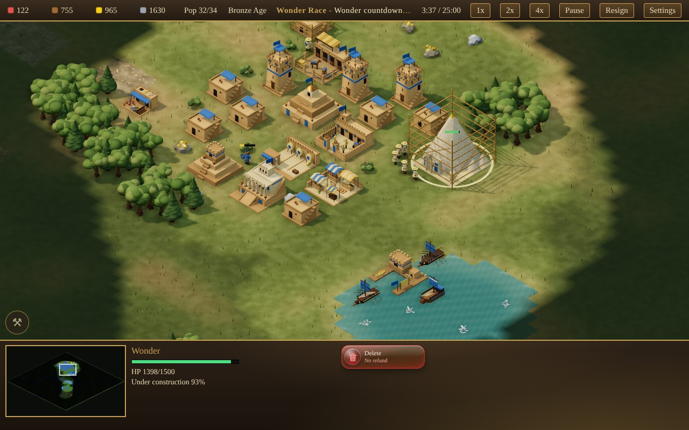
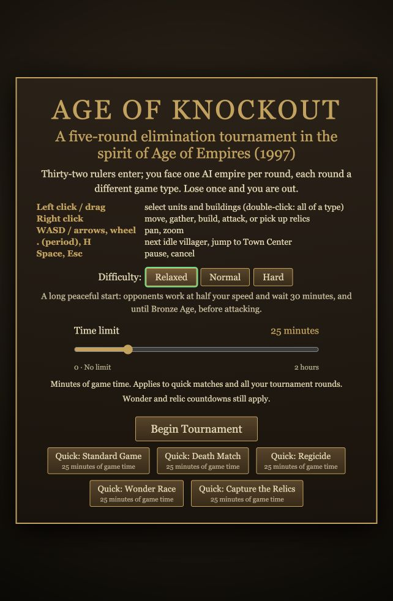
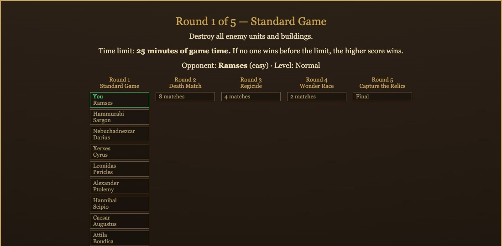
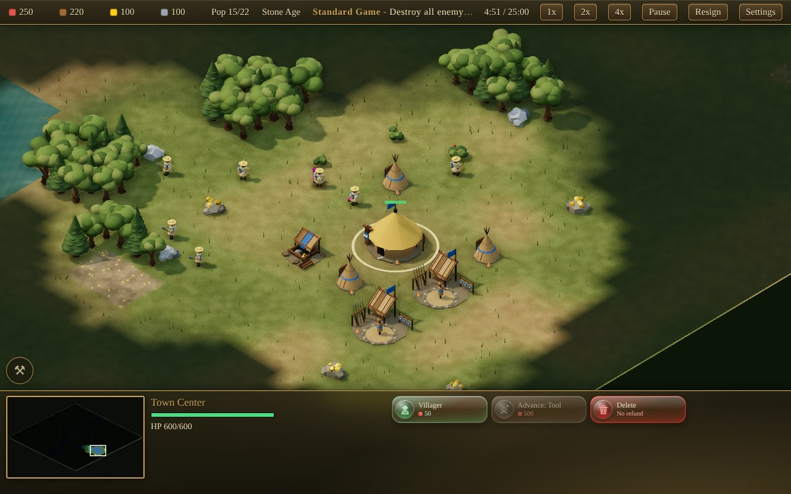
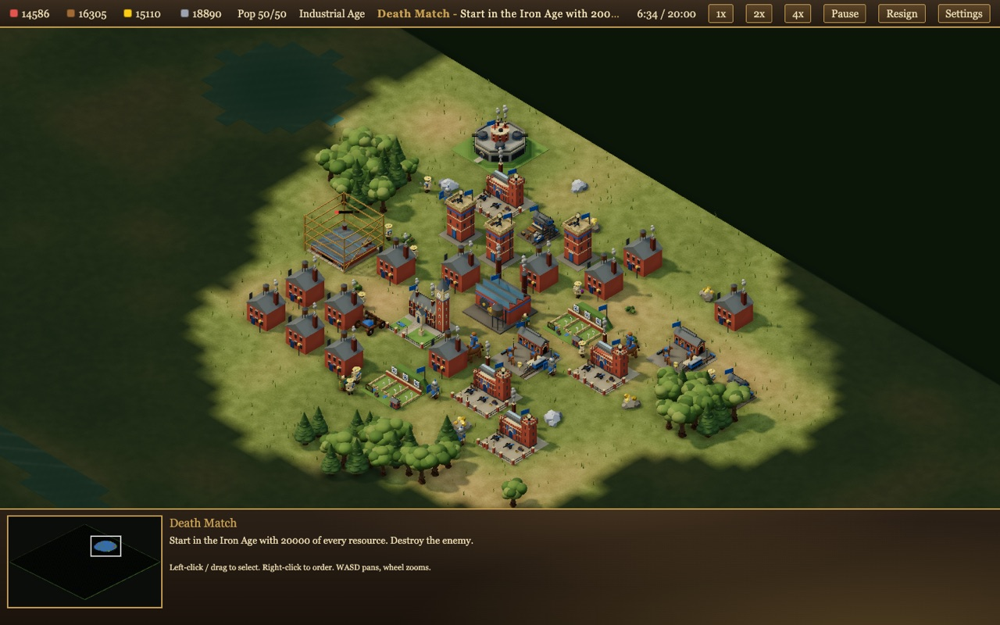
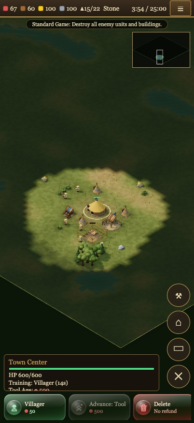
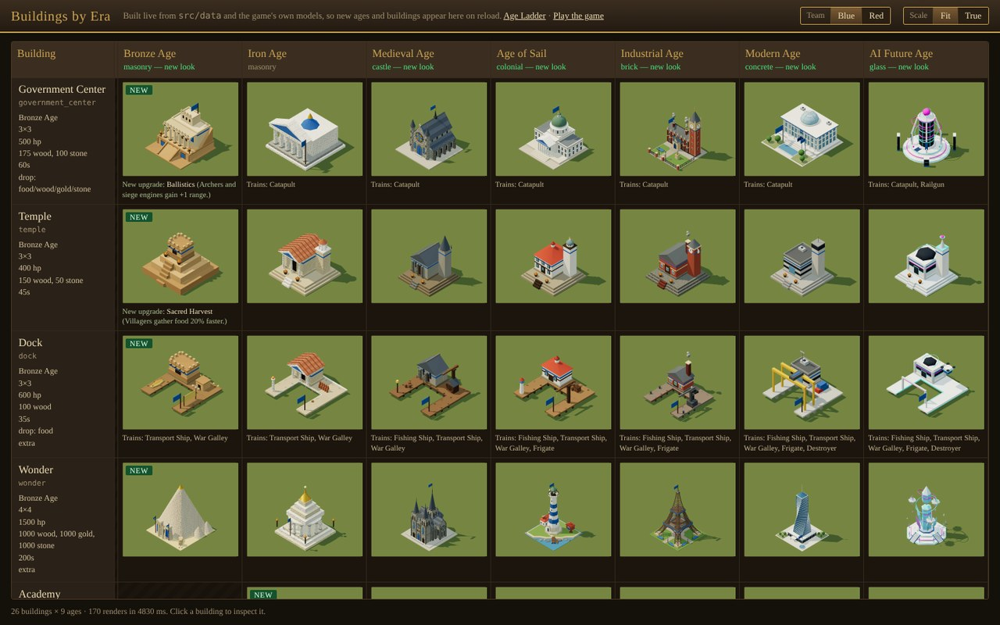
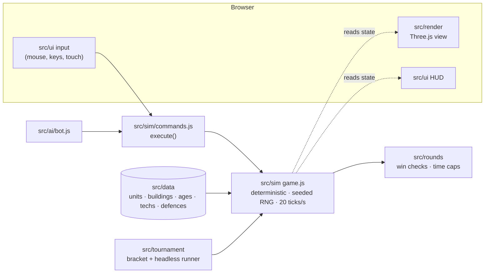

# Age of Knockout

A browser RTS in the spirit of Age of Empires I (1997), played as a 32-player knockout bracket of 1v1 matches
against AI. Five rounds, each a different game type: Standard (conquest), Death Match, Regicide, Wonder Race,
Capture the Relics. Lose once and you're out.

**Play it in the browser: https://ggrocco.github.io/age_of_knockout/**



## Run

```
npm install
npm start                       # node serve.js, then open http://localhost:8000/
npm test                        # simulation, rounds, bot, bracket, data and render-model tests
npm run lint                    # ESLint
node test/bot-sim.js 12         # bot-vs-bot termination check, 12 seeds x 5 rounds
```

No build step: plain ES modules, with three.js loaded through the import map in `index.html`.
For hardware render measurements, start the dev server and open `http://localhost:8000/test/tools/render-audit.html?quality=high`. The diagnostic reports CPU and asynchronous GPU timings, restores your saved graphics preference, and is excluded from the nginx image.

## How a tournament works



Pick a **difficulty**, set the **Time limit** slider, and press **Begin Tournament**, or jump straight into one
game type with a **Quick** button. Both choices are saved in this browser.
The difficulty sets the opponent for each of your five rounds:

| Level | Round 1 | Round 2 | Round 3 | Round 4 | Round 5 |
| --- | --- | --- | --- | --- | --- |
| Relaxed | relaxed | relaxed | relaxed | relaxed | relaxed |
| Normal | easy | easy | medium | medium | hard |
| Hard | medium | medium | hard | hard | hard |

Relaxed opponents work at half your speed and wait 30 minutes, and until the Bronze Age, before attacking.
Easy opponents keep a smaller army than medium and hard ones, but put their economy into reaching the next age and
quickly replace lost villagers.



Before each round the bracket shows the rules, the time limit and your opponent. The other matches in each round are
played out by bots in a background Worker so the progress screen stays responsive.

| Round | Game type | Goal |
| --- | --- | --- |
| 1 | Standard Game | Destroy all enemy units and buildings |
| 2 | Death Match | Start in the Iron Age with 20,000 of every resource; destroy the enemy |
| 3 | Regicide | Kill the enemy king, protect yours |
| 4 | Wonder Race | Build a Wonder (Bronze Age) and keep it standing for 3 minutes |
| 5 | Capture the Relics | Hold all 5 relics in your Town Center for 3 minutes |

**Time limits.** The slider applies to quick matches and all five of your tournament rounds, in every mode and
difficulty, including Relaxed.

| Slider value | Match time limit |
| --- | --- |
| **25** (default) | 25 minutes of game time |
| **1–120** | Choose a limit in one-minute steps, up to 2 hours |
| **0** | No time limit |

If no one wins before a finite limit, the higher score wins. Speed controls change how quickly game time passes;
pausing stops the clock, which shows elapsed / limit. The Quick buttons and bracket show your chosen limit before
you play. On desktop, hover or keyboard-focus a Quick button, a bracket round heading, or the in-game objective or
clock for a card with the mode's goal, time limit and scoring.

At **0**, the clock shows `elapsed / ∞`, and normal victory conditions, Wonder/relic countdowns and resigning still
end a match. A saved choice from the former No time limit checkbox becomes 0. Off-screen AI bracket matches keep
their finite mode/difficulty limits so the bracket always resolves.

## Playing



You start in the Stone Age (Death Match: Iron Age) with a Town Center and a few villagers on a 96-tile map, at a random point on a ring
around the centre (the opponent mirrors you). Gather food, wood, gold and stone, build houses for population, and
**advance through nine eras**: Stone, Tool, Bronze, Iron, Medieval, Age of Sail, Industrial, Modern and AI Future.
Each era unlocks units and buildings and changes how your buildings look. To advance you need a Town Center and
**two finished buildings of your current era**, as in AoE1, and every era but the last has exactly two of its own:

| Leaving | Build both of |
| --- | --- |
| Stone | two of House, Granary, Storage Pit, Barracks |
| Tool | two of Archery Range, Stable, Market |
| Bronze | Government Center and Temple |
| Iron | Academy and Siege Workshop |
| Medieval | Castle and University |
| Age of Sail | Arsenal and Trading Company |
| Industrial | Factory and Railway Station |
| Modern | Power Plant and Airfield |

The new gate buildings each research one upgrade: Sacred Harvest (Temple, food +20%), Phalanx Drill (Academy, infantry
+20 HP), Torsion Engines (Siege Workshop, siege +10 attack), Masonry (University, stone +25%), Bayonets (Arsenal, ranged
foot units +2 melee armor), Colonial Trade (Trading Company, gold +20%), Railways (Railway Station, every unit 10% faster),
Electrification (Power Plant, all gathering +10%) and Air Support (Airfield, Tanks and siege +30 HP). Farms, Mines,
Towers, Walls and the Wonder never count. Soldiers trained in an earlier era take on
the current one's look too: uniforms and weapon finish change, horses give way to motorbikes and hoverbikes, and
catapults and trebuchets become mortars and rocket batteries from the Age of Sail on. Villagers and the King keep one look.
Each era also raises the population limit that houses can reach: 50 in the Stone Age, then 65, 80, 100, 120, 140, 160,
180 and 200 in AI Future (each house adds 4, the Town Center 10).
Farms grow with the eras too: a Farm holds 400 food in the Stone Age, then 500, 600, 750, 900, 1050, 1250, 1500 and
1800 in AI Future, and villagers work it faster (normal speed in Stone, up to 2.4x in AI Future). When you advance,
every Farm you already have grows to the new size and keeps its share of food left.



**Towers and walls** get stronger when you advance: every existing tower and wall section re-scales to your current
era, and the tower's weapon changes with it (arrows, cannon, machine guns, beams). Draw a wall by dragging its line (on touch: tap
where it starts, tap where it ends, then press Place); an enemy army with no way round it attacks the wall to break through.
The opponent puts a short wall line in front of each of its towers, on the side facing you, so attackers walk round it
under fire or stop to break it; it never walls in its own base, and it rebuilds lost sections. It also repairs damaged
buildings, finishes foundations its builders left, and rebuilds a lost Town Center.

**Mines and rocky ground.** The map has grey rocky ground: gold veins (yellow flecks) and quarries (grey).
From the Tool Age a villager can build a **Mine** (100 wood, 50 stone) on one; only rocky ground will take it. Right-click
the finished Mine with villagers and they dig gold or stone from it, carrying it to the nearest Storage Pit or Town Center.
Every Mine on a patch draws on the patch's one shared reserve (the inspect line reads "Gold left N"). When the reserve
runs dry the Mines collapse, the ground turns back to grass, and a fresh pair of patches of that kind appears elsewhere
on the map, one for each side, each holding a third of what the emptied patch started with. The rocky ground thins out:
once that third would be under 400 no new pair appears, and at most 8 gold and 4 stone patches exist at once. Loose gold and stone piles run out too: when a kind drops below a quarter of its starting
total, new mirrored piles appear (a block for each side, away from both bases and the centre). The opponent digs Mines on
its own half of the map when its piles run low.

### Controls (desktop)

Left click / drag select (double-click: all of a type) · right click move / gather / build / repair / attack / fetch relic ·
WASD or arrows pan, wheel zooms · `.` or the round button above the minimap (badge = count) next idle villager, `H` Town Center · hold Space and drag
with the left mouse button to pan · Esc pauses and resumes (a Paused dialog stops everything, working villagers
included; during a building placement Esc cancels it instead) · click the minimap to jump. Select villagers to get the build menu, select a building to train units or advance the Age.

**Villagers go back to work.** Order a villager that is gathering or building to build something else and, once the
new building is done, it returns to what it was doing: the unfinished building first (several interruptions unwind
newest first), then the tree, mine, berries or farm it was working. A Farm or Mine it builds becomes its job at the end
of that chain instead, as in AoE. Move, attack or gather orders replace the whole chain.

**Repair a building:** select villagers and right-click (tap on touch) one of your finished, damaged buildings. They
put its HP back as fast as they would build it; full repair costs half the building's cost, paid as the HP goes back on,
and they stop when a resource it costs runs out. Selecting a damaged building shows what a full repair would cost.
Like a build, a repair returns the villager to the job it interrupted. A damaged building trains units and researches
at its share of full HP (a Barracks at 60% HP works at 60% speed, never below 25%); the info panel shows the slowdown,
and repairing brings it back to full speed.

**Delete a building:** select it and click **Delete**, or press **Delete / Backspace**. A confirmation dialog names
the building and pauses the match. Choose **Cancel** (or press **Esc**) to keep it, or **Delete building** to remove
it without a refund; queued training and research are lost. Closing the dialog restores your previous pause state.

**Group moves:** several units sent to one spot (right click on the ground or the minimap, or a tap on touch) spread out
around it in a block facing the way they march, one unit per tile: melee fighters in the front rows, then ranged units,
siege, and villagers at the back.

### Controls (phone / touch)



Tap your unit or building to select it; with a selection, tap a target to order it (ground = move, enemy = attack,
tree/mine/farm = gather, unfinished building = help build, damaged building = repair, relic = pick up). One finger drags the map, two fingers
pinch-zoom and pan.

Round buttons: next idle villager (badge = count), Town Center, box-select mode, deselect. Building placement: tap
or drag to position the ghost, then press Place. The menu button (top right) has pause, speed, resign and quit.

The **Delete** tile opens the same **Cancel / Delete building** confirmation as desktop, including for unfinished
buildings, towers and walls.

Both orientations are supported; use `?touch=1` to force the touch layout on a desktop browser. Not yet tested on a
real iPhone.

<br clear="right">

## Buildings by era



Open `http://localhost:8000/buildings.html` to see every building in every era, rendered with the game's own
models. Under each era it lists what the building trains by then and any upgrade it can start researching in that
era, with what the upgrade does. Switch Blue/Red team and Fit/True scale; click a building to orbit it or see it under construction. The page
reads `src/data`, so new eras and buildings appear on reload.

## How it's built



The player and the bot change the game only through `commands.js`. The simulation in `src/sim` has no DOM and a
seeded RNG, so the same match runs headlessly in tests, in `test/bot-sim.js` and for the other bracket matches. The renderer and HUD only read its state.

- `src/sim`: game state, unit orders, A* pathfinding, fog of war, towers and walls, map generation.
- `src/rounds`: the five game types, their win checks, time caps and score tiebreak.
- `src/ai`: the bot (relaxed / easy / medium / hard); it also plays your side with `&autoplay=1`.
- `src/tournament`: the 32-player bracket and headless match runner.
- `src/render`, `src/ui`, `src/main.js`: Three.js view, per-era building designs (`src/render/arch`), HUD, input
  and tournament flow.
- `src/data`: unit, building, age, tech and defence tables. Unit combat and cost stats are checked against
  openage's AoE1 manual data; buildings, age-up costs, techs, towers/walls and AI Future content are approximations
  or invented. See `src/data/README.md` for every deviation from AoE1.

## Rendering

The Three.js view uses warm directional lighting, filtered shadows, sky reflections, textured wood/stone/metal,
wind-blown grass, and reflective water with animated normals and shoreline foam. High and Ultra add ambient
occlusion for depth around buildings, foliage and units. Every era has its own building designs, from hide tents and
thatch through mud brick, terracotta tile, castles, colonial whitewash, industrial brick and modern concrete to AI Future
glass. Units have articulated equipment, including separate drone, mech and railgun models for AI Future, and fighters
from earlier eras are redrawn in their owner's current era. These are
original procedural models (no image or model files), not Age of Empires assets.

Choose **Settings → Graphics quality** on desktop, or open the top-right menu on a phone. Changes apply without
restarting the match and are saved in this browser. The default is **High**; try High on an iPhone 17 Pro and Ultra
on an M2 Max, then adjust for frame rate and battery use. These are starting recommendations, not measured
performance guarantees on those devices. Use `&quality=balanced|high|ultra` to override the saved preference.

| Preset | Maximum pixel ratio / rendered pixels | Shadow map | Ambient occlusion | Grass clumps |
| --- | --- | --- | --- | --- |
| Balanced | 1.5 / 2 million | 1024 | Off | 2,500 |
| High | 2 / 4 million | 2048 | Half resolution, 12 samples | 8,000 |
| Ultra | 2.5 / 8 million | 4096 | Three-quarter resolution, 24 samples | 14,000 |

No extra assets, network downloads, or build step are needed. Geometry is shared between models, every model is
drawn through one batched mesh, and grass is instanced. Decorative grass respects fog and building/resource
footprints. Float render-target support is checked before enabling sky reflections and ambient occlusion; direct
rendering remains available. `test/render-models.test.js` checks every unit and building era for valid geometry and
animation transforms, and `test/graphics-quality.test.js` covers preference handling, pixel budgets and the
rendering fallback. Shaders, picking, lighting and visual quality are checked in a browser.

Static model and contact-shadow transforms stay on the GPU until they change. Building flags, machinery, smoke and drone rotors use vertex-shader animation; terrain textures are baked on the GPU at match start and repainted there when ore patches change. Paused and result screens redraw at 10 FPS, while camera and selection changes remain responsive. Pausing freezes the animation clock. The simulation remains deterministic JavaScript at 20 ticks per second.

## URL parameters

| Param | Effect |
| --- | --- |
| `?round=1..5` | Start that round as a quick match, skipping the menus |
| `&opp=relaxed\|easy\|medium\|hard` | Opponent for `?round=` (default `medium`) |
| `&seed=N` | Replay a map; without it every match gets a fresh map and start position |
| `&speed=N` | Game speed multiplier |
| `&autoplay=1` | A bot plays your side; `&bot=easy\|medium\|hard` sets its difficulty (default `hard`) |
| `?autotour=1` | Whole tournament on autopilot |
| `?level=relaxed\|normal\|hard` | Tournament difficulty, overriding the saved menu pick |
| `?timeLimit=0..120` | Override the saved time limit in whole minutes; 0 = unlimited, default 25 |
| `?noTimeLimit=1\|0` | Legacy override: 1 = unlimited, 0 = 25 minutes; `timeLimit` takes precedence |
| `?touch=1` | Force the touch layout |
| `&fps=N` | Frame cap (default 60; redraws at 10 FPS while paused or on the result card, with immediate camera/selection updates) |
| `&quality=balanced\|high\|ultra` | Graphics preset |

`window.__app` exposes the live game for debugging. Try `?round=1&seed=1` for the starting village,
`?round=2&seed=3&autoplay=1&speed=8` to watch two bots race through the eras, and `?round=3&seed=1&touch=1` for the
phone layout.

For a custom deadline, use `?round=1&timeLimit=60` for a one-hour quick match or `?round=1&timeLimit=0` for no limit.

## Deploy (Docker)

```
docker compose up -d --build     # nginx image on http://localhost:8080/ (AOE_PORT=9000 to change)
```

The image is static files only (`index.html`, `buildings.html`, `styles.css`, `favicon.svg`, `src/`, the two
three.js folders the import map uses) behind nginx, with a healthcheck. Plain `docker build -t aoe-knockout .`
builds the same image.

## Deploy (GitHub Pages)

`.github/workflows/pages.yml` publishes the game to https://ggrocco.github.io/age_of_knockout/ on every push to `main` (or
by hand from the Actions tab). It runs `npm test`, assembles the same files as the nginx image and deploys them with
GitHub's Pages actions. One-time setup: **Settings > Pages > Source: GitHub Actions** (the repository must be public,
or on a plan that allows Pages for private repositories). Pages caches files for 10 minutes, so the workflow serves
`styles.css` and `src/` from `v/<content hash>/`, as the Docker image does; a new deploy reaches players within
about 10 minutes and never mixes old and new modules.

## CI (GitHub Actions)

`.github/workflows/ci.yml` runs on every pull request and every push to `main`:

- **Tests**: `npm test` and the `test/bot-sim.js 12` bot-vs-bot check.
- **Lint**: `npm run lint` (ESLint, `eslint.config.js`).
- **Security**: `npm audit` (fails on moderate or worse) and `npm audit signatures`; on pull requests, GitHub's
  dependency review blocks newly added vulnerable dependencies.

`.github/workflows/codeql.yml` runs CodeQL security analysis on the JavaScript and the workflow files on the same
events and once a week; findings show under **Security > Code scanning**.

## CI (Jenkins)

`Jenkinsfile` runs the unit tests (JUnit report), `test/bot-sim.js 12`, then builds the nginx image and smoke-tests
it (page, CSS, JS and both three.js import-map paths served with the right content type). Everything runs in Docker,
so the agent needs only the docker CLI with a reachable daemon (e.g. Jenkins in a container with
`/var/run/docker.sock` mounted and the docker CLI installed) and the JUnit plugin. Nothing is pushed or deployed.
Same tests without Jenkins:

```
docker build --target test -t aoe-knockout-test . && docker run --rm aoe-knockout-test
```

## Contributing

Issues, ideas and pull requests are welcome and much appreciated! Age of Knockout is a one-person project made just
for fun, so please expect slow replies and reviews. Contributor and agent notes are in `AGENTS.md`.

## Status

Rules, AI and bracket are covered by headless tests and bot-vs-bot runs; the renderer and UI were checked with
browser screenshots and scripted events. Feel, balance and fidelity to the original have not been judged by a human
player. `progress.md` records rulings, known gaps and deferred issues; design specs and plans are in
`docs/superpowers/`. Contributor and agent notes are in `AGENTS.md`.
